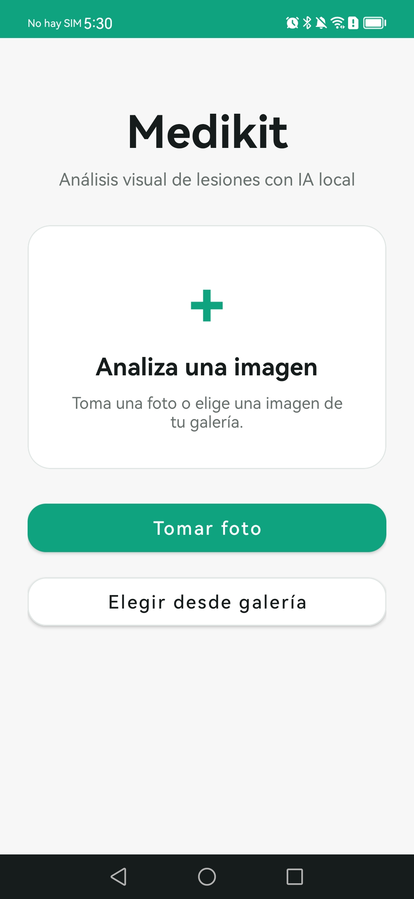
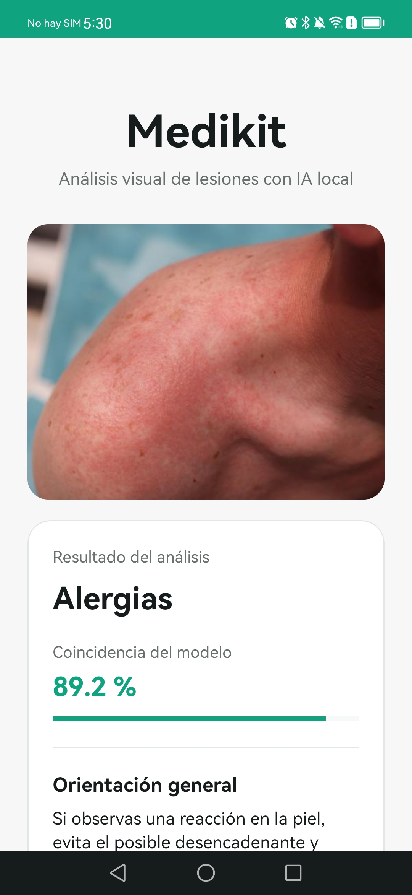
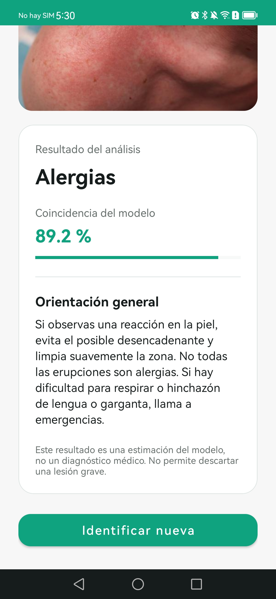

# Medikit AI

**Aplicación Android para clasificación visual experimental de lesiones mediante inteligencia artificial ejecutada localmente.**

Medikit AI es un proyecto académico desarrollado con **Java, Kotlin, Android SDK y TensorFlow Lite**. Permite capturar una imagen con la cámara o seleccionarla desde la galería, procesarla en el dispositivo y presentar la categoría predicha por un modelo de clasificación, junto con su puntuación de salida y recomendaciones generales de primeros auxilios.

> **Aviso importante:** Medikit AI es un prototipo educativo y **no proporciona diagnósticos médicos**. La puntuación del modelo no representa una probabilidad clínica de acierto. La clasificación de una fotografía no permite confirmar o descartar fracturas, esguinces, infecciones u otras lesiones.

## Contribución

Este proyecto se desarrolló **a partir de un modelo de red neuronal que ya había sido entrenado**. La aportación se concentró en adaptar ese modelo para ejecutarlo en un dispositivo Android y construir la aplicación móvil que permite utilizarlo.

- **Conversión e integración del modelo:** conversión del modelo preentrenado de formato Keras (`.keras`) a TensorFlow Lite (`.tflite`) para posibilitar inferencia local en Android.
- **Desarrollo Android:** implementación e integración de la interfaz de usuario con Java y Kotlin.
- **Captura y selección de imágenes:** integración de la cámara del sistema Android y selección de imágenes desde galería.
- **Procesamiento e inferencia:** preparación de las imágenes para el formato de entrada esperado por el modelo y ejecución de la clasificación en el dispositivo, sin depender de una API remota.
- **Presentación de resultados:** visualización de la categoría, puntuación del modelo y mensajes de orientación general.
- **Pruebas funcionales:** compilación y ejecución del APK en un teléfono Android, incluyendo pruebas de captura, selección de imágenes y visualización de resultados.

## Créditos y procedencia del modelo

- **Modelo original / entrenamiento:** trabajo realizado por una tercera persona (GRECO RODRIGEZ).
- **Adaptación a Android y desarrollo de la aplicación:** DEREK SAUCEDA.

## Tecnologías utilizadas

- **Lenguajes:** Java y Kotlin.
- **Desarrollo móvil:** Android SDK, AndroidX y Gradle.
- **Inteligencia artificial:** TensorFlow Lite.
- **Formato del modelo original:** Keras (`.keras`).
- **Formato integrado en Android:** TensorFlow Lite (`.tflite`).
- **Cámara:** aplicación de cámara del sistema mediante Intent/Activity Result (no CameraX).

## Funcionamiento

1. El usuario toma una fotografía o selecciona una imagen existente.
2. La app ajusta la imagen al formato que espera el modelo (RGB, 224 × 224 píxeles, valores normalizados).
3. TensorFlow Lite ejecuta la inferencia **directamente en el teléfono**.
4. La aplicación muestra una categoría entre ocho posibles: alergias, cortaduras, esguinces, fracturas, hematomas, no lesiones, quemaduras y raspaduras.
5. Se presenta la puntuación de la clasificación y una orientación general, con una advertencia sobre sus limitaciones médicas.
6. El usuario puede iniciar otro análisis.

## Capturas de pantalla

### Pantalla principal


### Resultado de la clasificación
(screenshots/resultado2.jpg)


## Estado del proyecto

**Prototipo funcional.** El proyecto se ha compilado y ejecutado en un dispositivo Android real. Quedan pendientes la evaluación sistemática de exactitud con un conjunto de prueba independiente, la validación clínica, el análisis de sesgos y las pruebas más amplias de compatibilidad y rendimiento.

## Compilación

**Requisitos:** JDK 17, Android SDK (API 35 y Build Tools) y Gradle 8.7, o el Gradle Wrapper correspondiente.

Desde la raíz del proyecto:

```powershell
# Si cuentas con Gradle Wrapper
.\gradlew.bat assembleDebug

# O con Gradle 8.7 instalado y disponible en PATH
gradle assembleDebug
```

El APK de depuración se genera en `app/build/outputs/apk/debug/app-debug.apk`.

**Modelo:** para compilar y ejecutar la inferencia local se necesita un archivo autorizado `modelo_lesiones.tflite` en `app/src/main/assets/`. Si este repositorio no lo incluye por motivos de licencia, será necesario conseguirlo del titular de los derechos antes de realizar las pruebas.

## Privacidad

El análisis del prototipo se realiza localmente. Evita publicar fotografías de personas o datos clínicos identificables sin consentimiento y derechos de uso.
